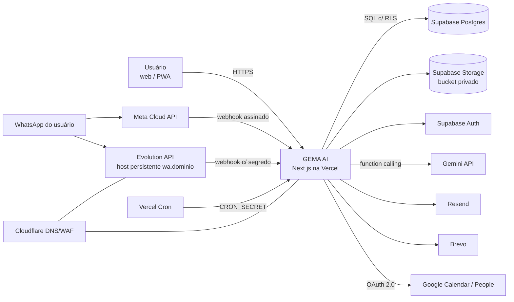
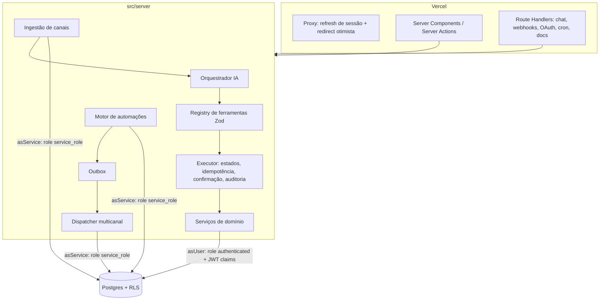

# Arquitetura

## Contexto (C4 nível 1)



## Contêineres (C4 nível 2)



## Decisões principais

| Decisão | Motivo |
|---|---|
| Acesso a dados via `postgres` com `set local role authenticated` + `request.jwt.claims` | RLS aplicada em **toda** consulta de usuário, transações reais e locks (`for update skip locked`). Mesmo SQL testado em PGlite. |
| IA só propõe `{tool, args}` | O modelo nunca toca o banco. Zod valida, RLS autoriza, executor registra estado e audita. |
| Datas relativas resolvidas no servidor (`relative_day`, `weekday`) | O modelo não calcula datas; timezone do usuário + relógio do servidor garantem "amanhã às 10" correto. |
| Valores em centavos (`bigint`) | Sem erro de ponto flutuante. |
| Idempotência por `idempotency_key` com `unique (workspace_id, idempotency_key)` | Webhook repetido / duplo envio não duplica lançamentos, eventos, tarefas ou execuções. |
| Outbox separado do envio | Preparação (automação) ≠ decisão de canal ≠ entrega; retries com backoff e dead-letter. |
| Evolution fora da Vercel | Sessões WhatsApp exigem processo persistente (sockets, QR). |
| Super Admin fora da RLS de cliente | Lê apenas agregados via service role, com auditoria por página. |

## Fluxo: "gastei 85 no almoço e 40 no combustível" pelo WhatsApp

```mermaid
sequenceDiagram
  participant WA as Evolution/Meta
  participant WH as /api/webhooks/*
  participant ING as ingestWebhook
  participant ORC as handleUserMessage
  participant GM as Gemini
  participant EX as executor
  WA->>WH: POST (assinatura/segredo)
  WH->>ING: verifica + replay protection
  ING->>ING: ignora fromMe; resolve titular por channel_account verificada
  ING->>ORC: mensagem (dedupe por provider_message_id)
  ORC->>GM: system + histórico (se consentido) + texto
  GM-->>ORC: create_expense{items:[85, 40]}
  ORC->>EX: executa (idempotency_key = provider:msgid:i)
  EX-->>ORC: succeeded (2 transações)
  ORC-->>ING: "✓ 2 despesas registradas, total R$ 125,00"
  ING->>WA: sendText
```
