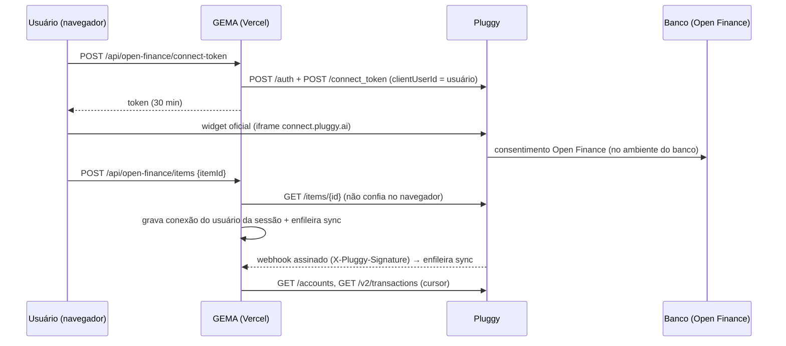

# Open Finance

**Estado (27/11/2026):** implementado e testado com Pluggy simulada (contrato). **Sandbox real pendente** de credenciais (BLK-05).
Somente leitura. O GEMA AI não faz pagamentos, PIX, transferências nem investimentos.

## Arquitetura

- `BankProvider` (`src/server/open-finance/types.ts`) isola o fornecedor. Implementação: `PluggyProvider`. Belvo: flag `integration.belvo` desligada (não implementado).
- Sincronização (`src/server/open-finance/sync.ts`) roda na fila persistente (`open_finance.sync`), com retry/backoff para 429/5xx e dead-letter.
- Agendamento: varredura diária (`open_finance.schedule`) + webhook + manual (limitado a 4/h por usuário).

## Mapeamento

| Pluggy | GEMA |
|---|---|
| Item | `bank_connections` (status normalizado, `consent_expires_at`) |
| Account BANK | `bank_accounts` (kind `bank`) → cria `financial_accounts` |
| Account CREDIT | `bank_accounts` (kind `credit`) → cria `credit_cards` (`source = open_finance`) |
| `balance` | `balance_cents` + `balance_at` (data informada) + `balance_snapshots` |
| Transaction DEBIT | `transactions.kind = expense` |
| Transaction CREDIT (conta) | `income` |
| Transaction CREDIT (cartão) | `card_payment` (pagamento de fatura) ou `refund` (estorno) |
| `status` PENDING/POSTED | `pending`/`paid` (atualizado na reimportação) |
| `creditCardMetadata` | `installment_number/total` |
| `id` | `external_id` com `unique (workspace_id, external_source, external_id)` — nunca duplica |

`date` vem em UTC; a data local é convertida para GMT-3.

## Status da conexão

`connecting`, `syncing`, `updated`, `outdated`, `error`, `consent_expired`, `revoked`, `waiting_user`, `unavailable`.
Consentimento expirado ou revogado: a Pluggy devolve **dados vazios sem erro**; o GEMA trata isso explicitamente (sync pulado, status
`consent_expired`/`revoked`) e não interpreta como "sem transações".

## Segurança

- Senha bancária digitada apenas no widget oficial (iframe `connect.pluggy.ai`, liberado na CSP).
- `clientUserId` dentro de `options` (na raiz a Pluggy descarta em silêncio).
- Item de outro titular nunca é reatribuído (upsert condicionado a workspace+titular).
- Cliente só altera `visibility` da conexão; status, ids e consentimento são gravados pelo servidor. Contas, saldos, logs e cursores são server-only para escrita.
- Webhook: HMAC-SHA256 de `"<t>.<corpo cru>"` com `PLUGGY_WEBHOOK_SECRET`, janela de 5 min, dedupe por `eventId`; o payload só dispara um sync que relê o item na API.
- Revogação: `DELETE /items/{id}` (revoga o consentimento Open Finance no provedor) + `revoked_at` + auditoria. Dados já importados permanecem até exclusão de conta/dados pelo titular (LGPD).

## Limites do provedor (doc oficial)

API Key 2 h; connect token 30 min; `PATCH /items` 20/min; demais 360/min por endpoint; webhook com 2xx em até 10 s e até 3 tentativas.
`/v2/transactions` (cursor) — o endpoint paginado antigo é descontinuado em 31/12/2026.
Plano gratuito: apenas conectores de sandbox (Pluggy Bank: `user-ok`/`password-ok`).

## Para homologar (BLK-05)

1. Criar conta Pluggy → Application → `PLUGGY_CLIENT_ID`/`PLUGGY_CLIENT_SECRET`.
2. Gerar signing secret de webhook → `PLUGGY_WEBHOOK_SECRET`; `PLUGGY_INCLUDE_SANDBOX=true`.
3. Deploy em HTTPS público (webhook exige HTTPS).
4. Conectar "Pluggy Bank" pelo widget e validar contas, transações, cartão, revogação (Fluxo D).
5. Produção: contrato comercial Pluggy (decisão do proprietário).
